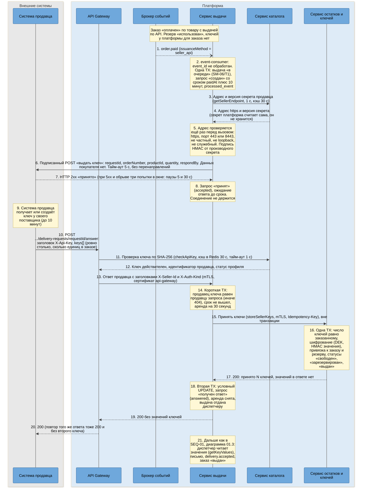
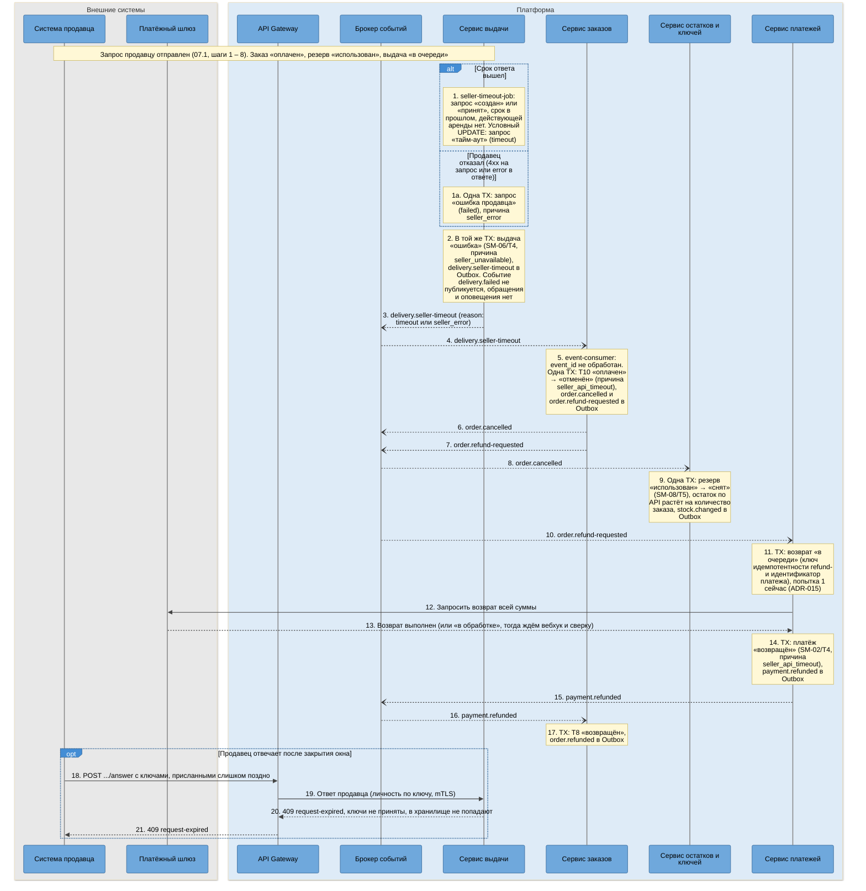

# SEQ-07. Выдача по запросу к системе продавца: ответ в срок и молчание

| Поле | Содержание |
| --- | --- |
| ID | SEQ-07 (диаграммы 07.1 и 07.2) |
| Релиз | R2 |
| Фаза | Ф5, срез 1, шаг 2 |
| Источники | [UC-03](../02-requirements/UC-03-key-issuance.md), [SM-01](../03-processes/SM-01-order.md) (T10), [SM-06](../03-processes/SM-06-delivery.md) (T1, T4), [SM-08](../03-processes/SM-08-reservation.md) (T5), [SM-03](../03-processes/SM-03-key.md), [SM-02](../03-processes/SM-02-payment.md) (T4), [asyncapi.yaml](../06-api/asyncapi/asyncapi.yaml) (`order.paid`, `delivery.seller-timeout`, `order.cancelled`, `order.refund-requested`) |
| Решения | [ADR-028](adr/ADR-028-seller-delivery-request.md) (запрос, ответ, окно, ключ в хранилище ключей), [ADR-027](adr/ADR-027-api-key-access.md) (доступ по API-ключу), [ADR-004](adr/ADR-004-saga-purchase.md), [ADR-005](adr/ADR-005-transactional-outbox.md), [ADR-006](adr/ADR-006-idempotency.md), [ADR-009](adr/ADR-009-key-encryption-hmac.md), [ADR-015](adr/ADR-015-payment-gateway-integration.md) (автовозврат) |
| Нотация | [c4-notation.md](c4-notation.md), раздел 8 |
| Предыдущий сценарий | [SEQ-01](sequence-purchase.md), диаграмма 01.3 (выдача и письмо) |

## 1. Цель и границы

Показать, как заказ на товар с выдачей по API (FT-4.3) получает ключ от системы продавца после оплаты (FT-7.4, US-6.7) и что происходит, если продавец молчит или отказывает: заказ отменяется (SM-01/T10), деньги возвращаются автоматически, остаток возвращается продавцу (SM-08/T5). Выбор асинхронной схемы «запрос, подтверждение приёма, ответ отдельным вызовом» объяснён в [ADR-028](adr/ADR-028-seller-delivery-request.md).

| Диаграмма | Что показывает | Переходы | Исключения BPMN-01 |
| --- | --- | --- | --- |
| 07.1 | Подписанный запрос продавцу, ответ с ключами в срок, шифрование в `inventory-service`, продолжение выдачи письмом | SM-06/T1 | нет |
| 07.2 | Срок вышел или продавец отказал: выдача «ошибка», отмена заказа, автовозврат, возврат остатка, поздний ответ | SM-06/T4, SM-01/T10, SM-08/T5, SM-02/T4, SM-01/T8 | нет |

Письмо покупателю, повторы отправки и контроль 30 минут не повторяются: после шага 21 диаграммы 07.1 выдача идёт по [SEQ-01](sequence-purchase.md), диаграмма 01.3, и [SEQ-03](sequence-guaranteed-delivery.md).

## 2. Участники

| Алиас | Роль в сценарии |
| --- | --- |
| `seller-systems` | Внешняя система продавца: принимает подписанный запрос, присылает ключи отдельным вызовом |
| `api-gateway` | Проверяет API-ключ, лимиты, передаёт личность продавца сервису заголовком по mTLS |
| `kafka` | События `order.paid`, `delivery.seller-timeout`, `order.cancelled`, `order.refund-requested`, `payment.refunded` |
| `delivery-service` | Запрос продавцу, приём ответа, тайм-аут, передача ключей на хранение |
| `catalog-service` | Проверка API-ключа, адрес и версия секрета подписи системы продавца |
| `inventory-service` | Остаток по API, шифрование и хранение присланных ключей, возврат остатка по `order.cancelled` |
| `order-service` | Переход T10 «оплачен → отменён», запрос возврата |
| `payment-service` | Автовозврат по механизму R1 |
| `payment-gateway` | Внешний шлюз: исполняет возврат (только 07.2) |

## 3. Предусловия и постусловия

| | Содержание |
| --- | --- |
| Предусловия | Заказ «оплачен» (SM-01/T4), резерв товара по API «использован» (SM-08/T2), ключей у платформы для заказа нет. Продавец подключил систему (`seller_integration` активна), у него есть действующий API-ключ. Окно ответа 10 минут (параметр `delivery.seller-response-seconds`) |
| Постусловия, 07.1 | Запрос «получен ответ» (`answered`), ключи в `inventory-service` в статусе «выдан» (SM-03/T4), выдача «в очереди» передана диспетчеру. Значений ключей в базе выдачи нет (INV-20) |
| Постусловия, 07.2 | Запрос «тайм-аут» или «ошибка продавца», выдача «ошибка» (причина `seller_unavailable`), заказ «возвращён» после платежа «возвращён», резерв «снят», остаток по API вырос. Событие `delivery.failed` не публиковалось |
| Инварианты | INV-08 (остаток по API не отрицателен), INV-18 (одна первичная выдача на заказ), INV-20 (значения ключей не хранятся и не логируются), INV-44 (персональных данных покупателя в запросе продавцу нет), INV-16 (заказ «возвращён» только при платеже «возвращён») |

## 4. Диаграмма 07.1. Ответ продавца в срок

**Что видно на диаграмме.**

- Окно в 10 минут не занимает соединений: после шага 8 платформа ждёт только по таблице, а продавец отвечает вызовом, который сам инициирует (шаги 10 – 13).
- Ключ продавца попадает в `inventory-service` сразу (шаг 15) и там шифруется как обычный. В базе выдачи значения нет, поэтому письмо, повторная отправка по обращению и защита от двойной выдачи работают без отличий от R1 ([ADR-009](adr/ADR-009-key-encryption-hmac.md)).
- Аренда на время приёма ответа (шаг 14) и условный `UPDATE` (шаг 18) исключают гонку «ключ сохранён, а заказ уже отменён по тайм-ауту»: `seller-timeout-job` пропускает запрос с действующей арендой.
- Заголовок личности на шаге 13 принимается только от сертификата `api-gateway` и только у операций с API-ключом ([ADR-027](adr/ADR-027-api-key-access.md)).

### 4.1. Шаги диаграммы 07.1

| № | Что происходит | Компонент | Статусы после шага | Переход SM |
| --- | --- | --- | --- | --- |
| 1 | Событие «заказ оплачен» с признаком способа выдачи | `outbox-relay` → `kafka` → `event-consumer` | Без изменений | нет |
| 2 | Создаётся выдача и запрос продавцу | `event-consumer`, `delivery-domain`, `seller-request-service` | Выдача: «в очереди». Запрос: «создан» (`requested`) | SM-06/T1 |
| 3 – 4 | Адрес и версия секрета продавца | `seller-request-job` → `seller-integration-controller` | Без изменений | нет |
| 5 – 7 | Подписанный запрос продавцу, продавец принял | `seller-request-job`, `seller-api-client` → `seller-systems` | Без изменений | нет |
| 8 | Запрос помечен принятым | `seller-request-service` | Запрос: «принят» (`accepted`) | нет |
| 9 | Продавец готовит ключ | `seller-systems` | Без изменений | нет |
| 10 | Продавец присылает ключи | `seller-systems` → `api-gateway` | Без изменений | нет |
| 11 – 12 | Проверка API-ключа | `api-gateway` → `api-key-check-controller` | Без изменений | нет |
| 13 – 14 | Ответ принят к обработке, аренда | `seller-answer-controller`, `seller-request-service` | Запрос: «принят», аренда 30 с | нет |
| 15 – 17 | Ключи на хранение | `key-client` → `seller-key-intake`, `key-crypto` | Ключи: «выдан», привязаны к заказу. Резерв: «использован» | SM-03/T1, T2 и T4 |
| 18 | Запрос закрыт ответом | `seller-request-service` | Запрос: «получен ответ» (`answered`). Выдача: «в очереди», доступна диспетчеру | нет |
| 19 – 20 | Ответ продавцу | `seller-answer-controller` → `api-gateway` | Без изменений | нет |
| 21 | Дальше выдача как в R1 | `delivery-dispatcher` | По SEQ-01, 01.3 | нет |

### 4.2. Времена и повторы диаграммы 07.1

| Параметр | Значение | Источник |
| --- | --- | --- |
| Ответ API продавца при выдаче | 10 мин, затем SM-01/T10 (параметр `delivery.seller-response-seconds`, умолчание 600, границы 30 – 900) | ADR-028, time-budgets.md |
| Вызов продавца | Тайм-аут 5 с, ответ до 64 КБ, без перенаправлений, при 5xx, тайм-ауте и обрыве три попытки внутри окна с паузами 5 и 30 с, при 4xx отказ без повтора | ADR-028 |
| Адрес и версия секрета | Тайм-аут вызова 1 с, кэш 30 с | ADR-028, ADR-021 |
| Проверка API-ключа | Тайм-аут 1 с, кэш шлюза 30 с, отказ в кэше 5 с | ADR-027 |
| Аренда на приём ответа | 30 с, снимается при сбое хранилища ключей, ответ 503 и повтор продавцом | ADR-028 |
| Сохранение ключей | Идемпотентно по `Idempotency-Key`, повтор с теми же ключами даёт тот же итог | ADR-006, ADR-028 |

## 5. Диаграмма 07.2. Продавец молчит или отказал: отмена, возврат, остаток

Продолжает диаграмму 07.1 после шага 8: запрос продавцу ушёл, ключи не пришли.

**Что видно на диаграмме.**

- Исход ведёт сага заказа, а не `delivery-service`: выдача только объявляет «продавец не ответил» (шаг 3), остальное делают заказ, остатки и платежи по своим событиям и каждое звено идемпотентно по `processed_event` ([ADR-004](adr/ADR-004-saga-purchase.md), [ADR-006](adr/ADR-006-idempotency.md)).
- Событие `delivery.failed` не публикуется (шаг 2): письма не было, и платформа не пишет администратору о «недоставленном письме». Обращение системы по контролю 30 минут не создаётся, потому что заказ отменяется раньше, чем окно контроля заканчивается.
- Возврат остатка (шаг 9) и деньги (шаги 11 – 15) идут параллельно и не ждут друг друга. Остаток вернётся продавцу, даже если шлюз возврата недоступен.
- Заказ становится «возвращён» только по событию `payment.refunded` (шаг 16, INV-16).
- Поздний ответ (шаги 18 – 21) безвреден: запрос закрыт, ключи в хранилище не попадают, продавец получает 409.

### 5.1. Шаги диаграммы 07.2

| № | Что происходит | Компонент | Статусы после шага | Переход SM |
| --- | --- | --- | --- | --- |
| 1 | Срок вышел без ответа | `seller-timeout-job`, `seller-request-service` | Запрос: «тайм-аут» (`timeout`) | нет |
| 1a | Продавец отказал | `seller-api-client`, `seller-request-service` | Запрос: «ошибка продавца» (`failed`) | нет |
| 2 | Выдача в ошибку, событие в Outbox | `delivery-domain`, `seller-request-service` | Выдача: «ошибка», причина `seller_unavailable`. `delivery.failed` нет | SM-06/T4 |
| 3 – 4 | Событие доставлено сервису заказов | `outbox-relay` → `kafka` → `event-consumer` | Без изменений | нет |
| 5 | Заказ отменяется | `seller-timeout-handler`, `order-domain` | Заказ: «отменён» (причина `seller_api_timeout`) | SM-01/T10 |
| 6 – 7 | События отмены и запроса возврата | `outbox-relay` | Без изменений | нет |
| 8 – 9 | Остаток возвращается | `kafka` → `event-consumer`, `reservation-service`, `api-stock-service` | Резерв: «снят». Остаток по API растёт | SM-08/T5 |
| 10 – 11 | Возврат принят в работу | `kafka` → `event-consumer`, `refund-service` | Возврат: «в очереди» | нет |
| 12 – 13 | Запрос возврата у шлюза | `refund-worker`, `gateway-client` | Возврат: выполнен | нет |
| 14 | Платёж возвращён | `payment-domain` | Платёж: «возвращён» | SM-02/T4 |
| 15 – 16 | Событие доставлено сервису заказов | `outbox-relay` → `kafka` → `event-consumer` | Без изменений | нет |
| 17 | Заказ возвращён | `order-domain` | Заказ: «возвращён» | SM-01/T8 |
| 18 – 19 | Поздний ответ продавца | `seller-systems` → `api-gateway` → `seller-answer-controller` | Без изменений | нет |
| 20 – 21 | Отказ позднему ответу | `seller-answer-controller` → `api-gateway` | Без изменений | нет |

### 5.2. Времена и повторы диаграммы 07.2

| Параметр | Значение | Источник |
| --- | --- | --- |
| Тайм-аут продавца, запуск задания | Раз в секунду, берёт запросы со сроком в прошлом без аренды, `FOR UPDATE SKIP LOCKED` | ADR-028 |
| Обработка события заказом и остатками | При недоступности звена повторы потребителя (1, 5, 25 с), затем тема `.dlq` | ADR-011 |
| Автовозврат, попытки | 0, 30 с, 2 мин, 5 мин, 10 мин (накопительно 17 минут 30 секунд) | ADR-015 |
| Поздний ответ продавца | 409 `request-expired`, ответ, начатый до конца окна, имеет право закончиться | ADR-028 |

## 6. Покрытие исключений и переходов

| Что | Где нарисовано |
| --- | --- |
| SM-06/T1 | 07.1, шаг 2 |
| SM-06/T4 | 07.2, шаг 2 |
| SM-01/T10 | 07.2, шаг 5 |
| SM-01/T8 | 07.2, шаг 17 |
| SM-08/T5 | 07.2, шаги 8 – 9 |
| SM-02/T4 | 07.2, шаг 14 |
| SM-03/T1, T2 и T4 (ключи продавца) | 07.1, шаги 15 – 17 |

## 7. Что произойдёт при сбое

| Точка падения | Что происходит | Чем закрыто |
| --- | --- | --- |
| `delivery-service` упал после шага 2 диаграммы 07.1, до шага 6 | Выдача и запрос «создан» есть, запрос продавцу не ушёл | `seller-request-job` берёт запрос по состоянию в базе после перезапуска, окно считается от оплаты, а не от запуска |
| Продавец принял запрос (шаг 7) и молчит | Запрос «принят», ключей нет | Окно закрывается, 07.2: отмена, возврат, остаток |
| Сеть оборвала ответ продавцу на шаге 20 | Ключи приняты, продавец не знает | Повтор того же ответа: 200 без второго ключа, значения нет (идемпотентность по `requestId`) |
| `inventory-service` недоступен на шаге 15 | Ключи не сохранены, аренда стоит | Аренда снимается, ответ 503, продавец повторяет вызов. Пока аренда действует, тайм-аут запрос не закрывает |
| Тайм-аут и ответ продавца одновременно | Исход один | Аренда и условный `UPDATE`: проигравший получает отказ. Тест гонки, TC-968 |
| `order-service` упал после шага 5, до публикации | Заказ «отменён», события в Outbox | `outbox-relay` публикует после перезапуска, возврат и остаток идут по событиям |
| Шлюз возврата отказал на шагах 12 – 13 | Платёж «подтверждён», возврат «в очереди» | Повторы автовозврата и очередь администратора ([SEQ-02](sequence-late-payment.md), 02.2). Остаток уже вернулся |
| Адрес продавца отключён или не проходит проверку | Запрос не отправляется | Сразу ветвь «продавец отказал» (07.2, шаг 1a), причина `seller_error` |

## 8. Решения и замечания

| № | Вопрос | Решение | Причина |
| --- | --- | --- | --- |
| 1 | Как продавец отвечает | Отдельным вызовом с API-ключом, не в ответе на запрос | Окно 10 минут нельзя держать открытым соединением (ADR-028, вариант 3) |
| 2 | Публиковать ли `delivery.failed` при молчании продавца | Нет, публикуется `delivery.seller-timeout` | Письма не было, администратору не нужно оповещение о недоставке (Р-190) |
| 3 | Кто отменяет заказ | `order-service` по событию, не `delivery-service` вызовом | Исход ведёт сага, звенья независимы ([ADR-004](adr/ADR-004-saga-purchase.md)) |
| 4 | Где хранятся ключи продавца | Сразу в `inventory-service`, зашифрованными | INV-20, одна защита для всех ключей ([ADR-009](adr/ADR-009-key-encryption-hmac.md)) |
| 5 | Что в запросе продавцу | `requestId`, короткий номер заказа, товар, количество, срок | Продавец не получает данных покупателя (INV-44) |
| 6 | Повторный запрос продавцу при повторной отправке письма | Не делается | Ключ уже в хранилище, `getKeyValues` отдаёт его |

## 9. Связанные документы

- [SEQ-01](sequence-purchase.md): выдача и письмо после шага 21
- [SEQ-02](sequence-late-payment.md): автовозврат и очередь администратора
- [SEQ-03](sequence-guaranteed-delivery.md): повторы отправки письма и контроль 30 минут
- [c4-components-delivery-service.md](c4-components-delivery-service.md), [c4-components-catalog-service.md](c4-components-catalog-service.md), [c4-components-inventory-service.md](c4-components-inventory-service.md), [c4-components-order-service.md](c4-components-order-service.md), [c4-components-payment-service.md](c4-components-payment-service.md): компоненты из столбцов «Компонент»
- [c4-containers.md](c4-containers.md), раздел 9.1: связи R2
- [UC-03](../02-requirements/UC-03-key-issuance.md), [SM-06](../03-processes/SM-06-delivery.md), [SM-01](../03-processes/SM-01-order.md), [SM-08](../03-processes/SM-08-reservation.md)
